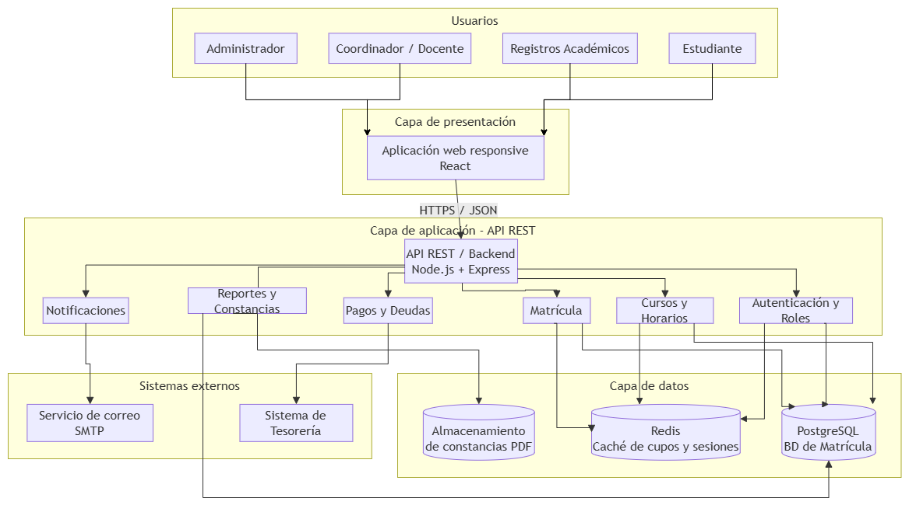

# A-03 · Arquitectura de Software

**Tema:** Sistema de Matrículas  
**Universidad:** Universidad Católica Sedes Sapientiae (UCSS)  
**Curso:** Ingeniería de Software 2 — Semana 10: Control de versiones y administración de artefactos  
**Estudiante:** Miguel  
**Fecha:** 28/10/2026  
**Artefacto:** A-03 (tipo: Diagrama / Documento)  
**Ruta en el repositorio:** `docs/03-arquitectura.md`  

---

## 3. Arquitectura (A-03)

Se propone una **arquitectura en capas de tipo cliente–servidor**:
1. **Capa de Presentación:** Una aplicación web basada en React (SPA responsive con Vite).
2. **Capa de Servicios y Negocio:** Una API REST desarrollada en Node.js + Express, organizada en módulos independientes por dominio de negocio.
3. **Capa de Persistencia y Caché:** Base de datos relacional PostgreSQL para persistencia transaccional y Redis para control de concurrencia y caché de cupos.
4. **Servicios Externos Integrados:** Sistema de Tesorería (consulta de deudas) y Servidor SMTP (notificaciones por correo electrónico).

La separación por módulos favorece las pruebas automatizadas, el mantenimiento y el control de versiones en Git, asegurando que los cambios en un componente no impacten negativamente a los demás.

---

### 3.1 Componentes del Sistema

| Componente | Tecnología prevista | Responsabilidad |
| :--- | :--- | :--- |
| **Aplicación Web (Frontend)** | React + Vite (SPA responsive) | Interfaz gráfica interactiva para estudiantes, coordinadores, Registros Académicos y administradores. |
| **API REST / Backend** | Node.js + Express | Punto de entrada único (Gateway); coordina middlewares, autenticación y llamadas a la lógica de negocio. |
| **Módulo de Autenticación y Roles** | JWT + bcrypt + RBAC | Validación de credenciales, emisión de tokens y control de permisos por endpoint. |
| **Módulo de Cursos y Horarios** | Node.js | Gestión de periodos académicos, cursos, secciones, horarios y consulta de vacantes. |
| **Módulo de Matrícula** | Node.js (`rules.js`, service, controller) | Validación de reglas de negocio (prerrequisitos, cupos, cruces de horario, créditos máximos) y confirmación de matrícula. |
| **Módulo de Pagos y Deudas** | Node.js (Cliente HTTP) | Integración con el sistema externo de Tesorería para verificar morosidad antes de la inscripción. |
| **Módulo de Reportes y Constancias** | Node.js + PDFKit | Generación dinámica de la constancia oficial de matrícula en PDF y listados de secciones. |
| **Módulo de Notificaciones** | Node.js + Nodemailer (SMTP) | Envío automático de confirmaciones de matrícula y alertas al correo institucional del estudiante. |
| **Base de Datos Principal** | PostgreSQL 15 | Almacenamiento persistente y transaccional (ACID) de usuarios, carreras, cursos, secciones y registros de auditoría. |
| **Caché en Memoria** | Redis | Gestión de sesiones concurrentes y reserva temporal de vacantes en periodos de alta demanda. |
| **Almacenamiento de Archivos** | File System / Object Storage | Almacenamiento seguro de constancias emitidas en formato PDF. |
| **Sistema de Tesorería (Externo)** | API REST Institucional | Fuente fidedigna del estado financiero de pagos de los estudiantes. |
| **Servicio de Correo (Externo)** | SMTP institucional | Infraestructura de entrega de correos electrónicos. |

---

### 3.2 Diagrama de Arquitectura

*Figura 1. Arquitectura modular cliente-servidor del Sistema de Matrículas.*
